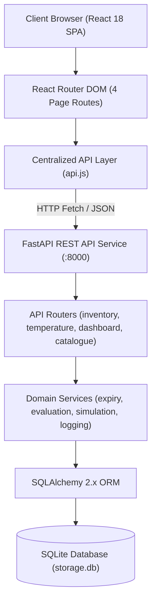

# FreshGuard – Smart Food Storage and Inventory Management System

FreshGuard is a college-level food storage, inventory tracking, and temperature compliance management system. Built with a **Python FastAPI** backend, **SQLite / SQLAlchemy ORM** database, and a **React + Vite** plain CSS frontend, FreshGuard helps households track food inventory, monitor storage temperatures against authoritative food safety standards (FoodSafety.gov & USDA FSIS), detect temperature breaches, track packaging shelf life, and review historical compliance logs.

---

## 1. Project Title & Introduction

- **Project Name**: FreshGuard (Smart Food Storage and Inventory Management System)
- **Application Type**: Full-Stack Single Page Application (SPA) & RESTful Web Service
- **Target Audience**: Households, student apartments, and small kitchens looking to organize food storage, minimize food waste, and follow evidence-based cold chain preservation standards.

---

## 2. Problem Statement

Household food waste and foodborne illnesses often stem from two primary issues:
1. **Lack of Inventory Visibility**: Food items in refrigerators, freezers, and pantries are forgotten, leading to expiration before consumption.
2. **Improper Storage Temperatures**: Household refrigerators and freezers frequently drift above safe limits due to power fluctuations, door seal degradation, or improper thermostat settings. When food enters the "Danger Zone" (4°C to 60°C / 40°F to 140°F), pathogenic bacteria (such as *Salmonella*, *Listeria*, and *Campylobacter*) can double every 20 minutes, accelerating spoilage without visible signs.

FreshGuard addresses these issues by offering an accessible inventory manager with authoritative storage temperature benchmarks and an interactive demonstration simulation engine.

---

## 3. Project Objectives

- Provide an intuitive web application to track food items across refrigerator, freezer, and pantry locations.
- Maintain a verified baseline food catalogue with scientific temperature ceilings and storage guidelines citing official FoodSafety.gov and USDA FSIS resources.
- Automatically calculate real-time shelf life and flag near-expiry (≤ 3 days) or expired items.
- Evaluate point-in-time Celsius temperature readings against storage thresholds (`≤ 4.0°C` for Refrigerated, `≤ -18.0°C` for Frozen, and Cool & Dry for Ambient).
- Provide a demo simulation tool (`safe`, `warning`, `random`) for testing alert handling and classroom presentations.
- Maintain a complete audit history of temperature readings and storage actions with filtering capabilities.

---

## 4. Key Features

- **Executive Safety Dashboard**:
  - Real-time counters: Total Stored Items, Expiring Soon, Expired Items, and Active Temperature Warnings.
  - Urgent Attention List: Highlighting items with active temperature breaches or upcoming expirations.
  - Recent Storage Activity Feed: Chronological audit log of user actions (`ITEM_ADDED`, `ITEM_UPDATED`, `ITEM_DELETED`, `TEMP_CHECKED`).
  - One-click refresh and quick navigation links.

- **Food Catalogue & Inventory Management**:
  - Predefined catalogue with 10 verified household items across 8 categories with external citation links.
  - Full CRUD: Add food items, edit quantities and locations, soft-delete with confirmation modal.
  - Live search by item name or category, and filtering by storage location and expiry status.
  - Dynamic shelf life calculation (`days_until_expiry` and statuses: `FRESH`, `NEAR_EXPIRY`, `EXPIRED`).

- **Temperature Checker & Demonstration Simulator**:
  - Active item selector with contextual metadata card displaying storage guidelines and target thresholds.
  - Manual temperature probe input with range validation (-50.0°C to +60.0°C).
  - Three calibrated demo simulation buttons:
    - **Safe Reading**: Calibrated within safe storage limits.
    - **Warning Reading**: Calibrated above recommended maximum ceilings to trigger alerts.
    - **Random Reading**: Dynamically generated reading for testing.
  - Authoritative evaluation cards displaying status (`WITHIN_LIMIT`, `ABOVE_LIMIT`, `NO_LIMIT`), temperature hero comparison, pathogen hazard advisories, and food safety citations.

- **Active Alerts & Temperature History**:
  - **Temperature Warnings**: Displays active breaches based strictly on the latest reading per active item. Warnings automatically clear upon recording a subsequent compliant check.
  - **Expiry Alerts**: Flags overdue and near-expiry items with remaining day countdowns.
  - **Preservation Tips**: Tailored category-specific storage advice based on items currently in the user's active inventory.
  - **Temperature History Audit Log**: Chronological table of all past manual and simulated readings, filterable by evaluation status and food item, with expandable message citations. Historical readings are preserved even when an inventory item is soft-deleted.

---

## 5. Technology Stack

### Backend
- **Language**: Python 3.10+ (tested on Python 3.14)
- **Web Framework**: FastAPI (high-performance asynchronous REST API)
- **ORM**: SQLAlchemy 2.x
- **Data Validation & Serialization**: Pydantic 2.x
- **Database**: SQLite (local single-file database with foreign key support enabled)
- **ASGI Server**: Uvicorn
- **Automated Testing**: Pytest

### Frontend
- **Framework**: React 18.3+ with Vite 6.x
- **Routing**: React Router DOM 6.x
- **Styling**: Plain CSS with CSS Custom Properties / Design Tokens (no heavy CSS libraries)
- **Design Tokens**: Soft sage, forest green, crisp white cards, and accessible semantic status badges

---

## 6. System Architecture



---

## 7. Folder Structure

```
Smart-Food-Storage-Management-System-/
├── backend/
│   ├── app/
│   │   ├── __init__.py
│   │   ├── database.py       # SQLite engine, session factory, foreign key pragma
│   │   ├── models.py         # SQLAlchemy ORM models (FoodCatalogue, InventoryItem, etc.)
│   │   ├── schemas.py        # Pydantic v2 schemas and request validators
│   │   ├── seed_data.py      # Idempotent seeding for FoodCatalogue
│   │   ├── services.py       # Core domain logic: expiry calculation, temperature checks, simulation
│   │   ├── main.py           # FastAPI app initialization, CORS, and routers
│   │   └── routers/
│   │       ├── __init__.py
│   │       ├── inventory.py   # CRUD for active inventory items & catalogue
│   │       ├── temperature.py # Manual checks, simulations, and history
│   │       └── dashboard.py   # Dashboard statistics and active alerts
│   ├── tests/
│   │   ├── conftest.py       # Isolated test database fixtures
│   │   ├── test_foundation.py# Phase 1 backend foundation tests (8 tests)
│   │   └── test_phase2_api.py # Phase 2 domain API tests (18 tests)
│   ├── requirements.txt      # Backend Python dependencies
│   └── storage.db            # SQLite database file (runtime, gitignored)
├── frontend/
│   ├── src/
│   │   ├── components/       # Reusable UI primitives (Card, Header, Sidebar, Modal, StatusBadge, etc.)
│   │   ├── pages/            # Page shells (Dashboard, Inventory, Checker, AlertsHistory)
│   │   ├── services/
│   │   │   └── api.js        # Centralized fetch service with error parsing
│   │   ├── App.jsx           # Root layout & route configuration
│   │   ├── main.jsx          # React DOM entry point
│   │   └── index.css         # Plain CSS design system tokens and responsive rules
│   ├── package.json          # Node dependencies and scripts
│   ├── vite.config.js        # Vite configuration
│   └── .env.example          # Frontend environment template
├── .env.example              # Project-level environment template
├── .gitignore                # Comprehensive ignore rules (.env, storage.db, node_modules, etc.)
└── README.md                 # Complete project documentation
```

---

## 8. Database Overview

The SQLite database (`backend/storage.db`) consists of four relational tables with foreign key constraints enforced:

1. **`food_catalogues`**: Baseline catalog with 10 predefined items across 8 categories (Dairy, Poultry, Ground Beef, Seafood, Eggs, Produce, Frozen Foods, Leftovers, Pantry). Contains `storage_type` (`REFRIGERATED`, `FROZEN`, `AMBIENT`), `max_temp_c`, `storage_guidance`, and official FoodSafety.gov/USDA citations.
2. **`inventory_items`**: User-managed items referencing `food_catalogues.id`. Contains `custom_name`, `quantity`, `unit`, `storage_location`, `purchase_date`, `expiry_date`, and `is_active` (for soft deletion).
3. **`temperature_checks`**: Log of manual and simulated readings referencing `inventory_items.id`. Contains `recorded_temp_c`, `status` (`WITHIN_LIMIT`, `ABOVE_LIMIT`, `NO_LIMIT`), `message`, `is_simulated`, and `checked_at`.
4. **`activity_logs`**: System audit trail containing `action_type` (`ITEM_ADDED`, `ITEM_UPDATED`, `ITEM_DELETED`, `TEMP_CHECKED`), `description`, and `created_at`.

---

## 9. Application UI & Page Overview

- **Dashboard (`/`)**: High-level KPIs, Items Requiring Attention list, Recent Activity timeline, and household storage standards reference.
- **Food Inventory (`/`)**: Collapsible verified food catalogue, active inventory table with search and filters, "+ Add Food Item" modal, inline edit modal, and soft-delete confirmation modal.
- **Temperature Checker (`/checker`)**: Inventory item selector, item metadata card, manual Celsius probe entry, Safe/Warning/Random demo simulator buttons, and authoritative evaluation result card.
- **Alerts & Temperature History (`/alerts`)**: Dual-tab interface containing active temperature breach cards, near-expiry and expired alerts, tailored category preservation tips, and a filterable temperature audit history table.

---

## 10. Installation Instructions

### Prerequisites
- Python 3.10 or higher
- Node.js 18.x or higher and npm

### 1. Clone the Repository
```bash
git clone https://github.com/priyapandey-maker/Smart-Food-Storage-Management-System-.git
cd Smart-Food-Storage-Management-System-
```

### 2. Backend Setup
```bash
# Create a Python virtual environment
python -m venv .venv

# Activate the virtual environment
# Windows (PowerShell):
.\.venv\Scripts\Activate.ps1
# Linux / macOS:
source .venv/bin/activate

# Install dependencies
pip install -r backend/requirements.txt
```

### 3. Frontend Setup
```bash
cd frontend
npm install
cd ..
```

---

## 11. Running the Application

### Start the Backend (Terminal 1)
```bash
# From root directory with virtual environment activated:
cd backend
python -m uvicorn app.main:app --reload --host 127.0.0.1 --port 8000
```
- The backend API will be available at: `http://127.0.0.1:8000`
- Interactive Swagger API docs: `http://127.0.0.1:8000/docs`
- Health check endpoint: `http://127.0.0.1:8000/health`

### Start the Frontend (Terminal 2)
```bash
# In a new terminal window:
cd frontend
npm run dev
```
- The frontend will be available at: `http://127.0.0.1:5173`

---

## 12. API Overview

| Method | Endpoint | Description |
| :--- | :--- | :--- |
| `GET` | `/health` | Server and database connectivity check |
| `GET` | `/api/catalogue` | List all 10 predefined food catalogue items |
| `GET` | `/api/catalogue/{id}` | Get individual catalogue item details |
| `GET` | `/api/inventory` | List active items; supports `storage_location` and `expiry_status` query filters |
| `GET` | `/api/inventory/{id}` | Get active item by ID including latest temperature check |
| `POST` | `/api/inventory` | Create inventory item; validates `quantity > 0` and `expiry_date >= purchase_date` |
| `PUT` | `/api/inventory/{id}` | Update existing inventory item |
| `DELETE`| `/api/inventory/{id}` | Soft-delete inventory item (`is_active = False`) |
| `POST` | `/api/temperature/check` | Record manual check (`is_simulated = False`) and evaluate thresholds |
| `POST` | `/api/temperature/simulate` | Generate calibrated demo reading (`mode: safe \| warning \| random`) |
| `GET` | `/api/temperature/history` | Chronological check history; supports `inventory_id`, `status`, and `limit` |
| `GET` | `/api/dashboard` | Dashboard metrics (`total_active_items`, `expiring_soon_count`, etc.) and recent logs |
| `GET` | `/api/alerts` | Active temperature warnings, expiry alerts, and tailored preservation tips |

---

## 13. Testing Instructions

### Run Backend Automated Tests
```bash
cd backend
python -m pytest -v
```
- Runs 26 automated unit and API integration tests.
- Uses an isolated SQLite database fixture without modifying or polluting `storage.db`.

### Run Frontend Production Build
```bash
cd frontend
npm run build
```
- Verifies JSX syntax, module imports, plain CSS bundling, and production asset generation.

---

## 14. Project Limitations

To maintain clear academic integrity for college project evaluation, the following constraints should be noted:
- **No Physical Hardware Sensors**: Temperature readings are entered manually by the user or generated via the calibrated demonstration simulator. No IoT hardware or Bluetooth thermometer probes are connected.
- **No Automatic Climate Control**: FreshGuard is an informational monitoring console; it does not interface with refrigerator compressors or smart thermostat actuators.
- **No Biological Spoilage Sensors**: The system computes safe storage compliance based on user-provided dates and temperatures against published guidelines. It does not perform biochemical spoilage detection.
- **Baseline Catalogue Reliance**: Storage guidelines and maximum thresholds rely on the 10 predefined catalogue items referencing FoodSafety.gov and USDA FSIS charts.

---

## 15. Future Scope

Potential enhancements for future iterations:
- Integration with ESP32 or Raspberry Pi microcontrollers and DS18B20 digital temperature sensors via MQTT or WebSockets.
- Barcode and QR code scanning for faster inventory entry.
- Push notifications or email alerts via Web Push API or SMTP when a refrigerator temperature breach persists.
- Multi-user authentication and household sharing.

---

## 16. Suggested 3–5 Minute Live Project Demonstration

When presenting FreshGuard for college evaluation, follow this structured demo sequence:

1. **Dashboard Overview (0:00 – 0:45)**:
   - Open `http://127.0.0.1:5173`. Point out the header showing live backend connection (`Backend Connected (v1.0.0)`).
   - Show the four summary cards: Total Items, Expiring Soon, Expired Items, and Temperature Warnings.
   - Explain the "Items Requiring Attention" card and Recent Storage Activity feed.

2. **Inventory Management & Catalogue (0:45 – 1:45)**:
   - Navigate to **Food Inventory** (`/inventory`).
   - Click "Browse Catalogue" to display the 10 verified items with FoodSafety.gov/USDA citations.
   - Click "+ Add Food Item" or use "+ Add to Inventory" from the catalogue (e.g. Fresh Milk, Refrigerator, expiring in 7 days).
   - Show how the item appears immediately in the table with a `FRESH` badge.
   - Add another item expiring tomorrow (e.g. Leftovers) to demonstrate the `NEAR_EXPIRY` badge.

3. **Temperature Evaluation & Demo Simulator (1:45 – 3:00)**:
   - Navigate to **Temperature Checker** (`/checker`).
   - Select the newly added Milk item from the dropdown. Review the target limit (`≤ 4.0°C`) and storage guidance.
   - Perform a manual check with compliant temperature (e.g. `3.2°C`). Point out the green `WITHIN_LIMIT` evaluation card and official message.
   - Click the "Simulate Warning Reading" button (e.g. generating `7.8°C`). Show the red `ABOVE_LIMIT` evaluation card highlighting the pathogen multiplication advisory.

4. **Alerts & Temperature History Synchronization (3:00 – 4:30)**:
   - Navigate to **Alerts & History** (`/alerts`).
   - Show that the Milk item now appears under **Active Temperature Warnings** with its breach reading (`7.8°C vs ≤ 4.0°C`).
   - Point out that the near-expiry item appears under **Upcoming & Overdue Expiry Alerts**.
   - Show the tailored **Preservation Guidelines** populated for active categories.
   - Switch to the **Temperature History Log** tab. Show how all readings (manual and simulated) are recorded with timestamps, statuses, and expandable detail rows.
   - Demonstrate the status filter (e.g. filter by `Above Limit`).

5. **Clearing Alerts & Soft Deletion (4:30 – 5:00)**:
   - Return to `/checker` and record a normal reading (`2.8°C`) for Milk.
   - Show that returning to `/alerts` or `/` immediately clears the active warning.
   - Return to `/inventory`, soft-delete an item, and show that while it disappears from active views, its check history remains preserved in the audit log.
